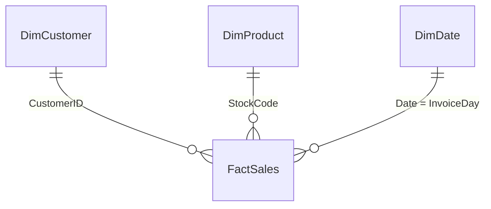

# Pulse in Power BI: build guide

The same analysis as the web dashboard (RFM segments, cohort retention, churn risk), rebuilt in Power BI so the logic is
visible as DAX. About 90 minutes in Power BI Desktop (free).

Everything is checked against the Python pipeline: `analysis/check_dax_logic.py` replays these formulas on the exact
tables you load and matches all 5,878 customers.

## 0. Make the data

```
cd analysis
python download_data.py        # once, ~45 MB from the UCI repository
python export_powerbi.py       # writes powerbi/data/*.csv
python check_dax_logic.py      # optional: proves the DAX logic matches the pipeline
```

## 1. Load

Power BI Desktop, Get data, Text/CSV. Load these three from `powerbi/data/`:

| File | Table name | Set these types |
|---|---|---|
| `fact_sales.csv` | `FactSales` | `Invoice` Text, `StockCode` Text, **`CustomerID` Whole number**, `InvoiceDate` **Date/Time**, `Quantity` Whole number, `UnitPrice` and `Revenue` Fixed decimal, `Country` Text |
| `dim_customer.csv` | `DimCustomer` | **`CustomerID` Whole number**, `Country` Text |
| `dim_product.csv` | `DimProduct` | `StockCode` Text, `Description` Text |

Do not load the `expected_*.csv` files into the model; they are only for checking (step 5).

## 2. Build the model

Paste from `measures.dax` in this order (each block is labelled):

1. Calculated tables: `Snapshot`, `DimDate`, `'Winback Rate'`, `'Segment Playbook'`
2. `DimCustomer[FirstPurchase]`, then the rest of the `DimCustomer` columns in the order written
3. `FactSales[InvoiceDay]`, then `FactSales[PeriodNumber]`  (needs `DimCustomer[CohortMonth]`)
4. Create an empty table `_Measures` (Home, Enter data), paste the measures, then hide its blank column

### Relationships (Model view)



| From (many) | To (one) | Direction |
|---|---|---|
| `FactSales[CustomerID]` | `DimCustomer[CustomerID]` | single, one to many |
| `FactSales[StockCode]` | `DimProduct[StockCode]` | single, one to many |
| `FactSales[InvoiceDay]` | `DimDate[Date]` | single, one to many |

`Snapshot`, `'Winback Rate'` and `'Segment Playbook'` have **no** relationships on purpose.
Then: mark `DimDate` as the date table (on `[Date]`), sort `DimDate[Month]` by `DimDate[Year Month]`, and hide
`RankKey_R/F/M`, `FirstPurchase`, `LastPurchase`, `LastOrderTime` and the key columns.

Why the customer columns use `RELATEDTABLE` and not `CALCULATE`: a calculated column that uses `CALCULATE` depends on
every column in its table, so columns that reference each other (frequency, scores, segment, risk) raise circular
dependency errors. The iterators avoid that.

## 3. Theme

View, Themes, Browse for themes, pick `theme.json`.

## 4. Pages

Canvas 1280 x 720. Titles say the finding, not the field (the headline measure writes it for you).

**1. Executive summary**
- Cards: `Total Revenue`, `Orders`, `Customers`, `Avg Order Value`, `Repeat Rate`
- Text box or card bound to `Headline`
- Area chart: X `DimDate[Month]`, Y `Total Revenue`
- Slicer: `DimDate[Year]`

**2. Segments**
- Bar chart: Y `DimCustomer[Segment]`, X `Total Revenue`; sort descending
- Donut or treemap: `Segment Revenue Share`
- Table: `'Segment Playbook'` (Segment, Who they are, What to do, Channel) next to a table of `Segment`, `Customers`, `Total Revenue`
- Slicer: `DimCustomer[Country]`

**3. Cohort retention**
- Matrix: Rows `DimCustomer[CohortMonth]`, Columns `FactSales[PeriodNumber]`, Values `Retention %`
  - Filter the visual to `PeriodNumber` between 0 and 6
  - Conditional format the values: background colour scale, minimum `#f4eee2` to maximum `#b4532a`
- Line chart: X `PeriodNumber`, Y `Retention %`, legend `DimCustomer[CohortMonth]` (limit to 3 cohorts)

**4. Churn risk**
- Cards: `High Risk Customers`, `Revenue At Risk`, `Revenue At Risk %`
- Donut: `DimCustomer[ChurnRisk]` by `Customers`
- Table: `CustomerID`, `Country`, `Segment`, `Monetary`, `RecencyDays`, `AvgOrderGapDays`; filter `ChurnRisk` is High risk; Top N 15 by `Monetary`

**5. Recommendations**
- Slicer: `'Winback Rate'[Value]` (single select, default 10%)
- Cards: `Revenue At Risk`, `Recovered Revenue`. **Label the second "Assumed recovery".** It is an input, not a finding.
- Text: three actions drawn from the data (protect Champions, personal outreach to At Risk and Can't Lose Them, one cheap reactivation for Hibernating)

## 5. Check your numbers

Values the report must show with no filters applied (from `expected_values.csv` and `expected_segments.csv`):

| Check | Expected |
|---|---|
| Total Revenue | 17,743,429 |
| Orders | 36,969 |
| Customers | 5,878 |
| Avg Order Value | 479.96 |
| High Risk Customers | see `expected_values.csv` (`high_risk_customers`) |
| Revenue At Risk | see `expected_values.csv` (`revenue_at_risk`) |
| Customers and revenue per segment | `expected_segments.csv` |
| Cohort 2009-12, month 3 | `expected_cohorts.csv` |

For a row-by-row check, load `expected_customers.csv` as a temporary table and compare `Segment` and `ChurnRisk`.

## 6. Publish

Take screenshots of each page for the README and the portfolio. Publish to web only makes sense because this dataset is
public; do not use it for private data.

## Troubleshooting

| Problem | Fix |
|---|---|
| Scores are all 1 or segments look wrong | `CustomerID` must be Whole number in both tables |
| "Circular dependency" | create `DimCustomer` columns in the order in `measures.dax`; do not swap the iterators for `CALCULATE` |
| `PeriodNumber` errors | create `DimCustomer[CohortMonth]` first; the relationship must exist |
| Retention % blank | the matrix columns must be `FactSales[PeriodNumber]`, not a date |
| Calculated columns take a minute | normal on the first load (805k rows) |
